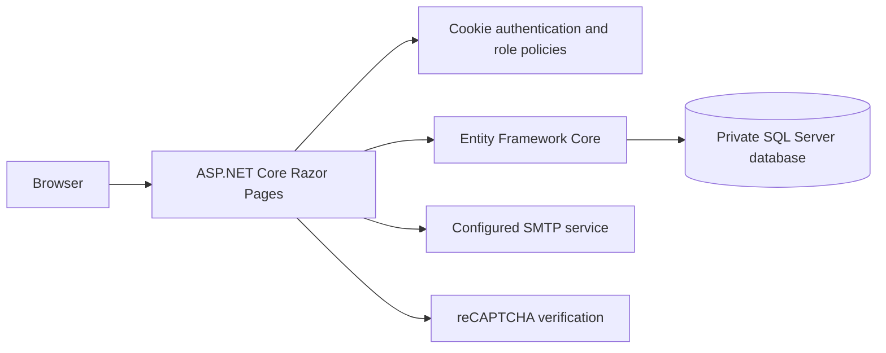

# Student Portal Development with Enhanced Security

An academic student portal built with ASP.NET Core Razor Pages, C#, Entity Framework Core, and SQL Server. The project explores authentication, authorization, account recovery, and audit logging alongside student administration workflows.

This repository contains the source code prepared for portfolio review. It excludes real database files, uploaded documents, local credentials, build output, and the original academic report. It is an academic prototype; the security limitations below should be addressed before any deployment with real users or data.

## Features

- Separate student, staff, and administrator areas with cookie authentication and role-claim authorization policies.
- Student login and email verification flows, BCrypt password and OTP hashing, failed-login tracking, password reset, and mandatory initial password changes.
- Login audit records with timestamps, IP addresses, and device information.
- Student registration and profiles, programme structures, timetables, attendance, co-curriculum registration, and examination results.
- Shared project modules for announcements, facility booking, leave applications, and billing.
- An academic AES encryption helper for sensitive profile fields. Its original CBC format is retained and has known limitations documented in [SECURITY.md](SECURITY.md).

## Technology

| Layer | Implementation |
| --- | --- |
| Web application | ASP.NET Core 10, Razor Pages, C# |
| Persistence | Entity Framework Core 10, SQL Server / LocalDB |
| Authentication | ASP.NET Core cookie schemes and role-claim policies |
| Password and OTP hashing | BCrypt.Net-Next |
| Email | SMTP integration, configured outside Git |
| Bot challenge | Google reCAPTCHA v2 integration |
| Frontend | Razor, JavaScript, CSS, Bootstrap and jQuery assets |

## Architecture



## Local setup

Prerequisites: .NET 10 SDK and SQL Server or SQL Server Express LocalDB. SMTP and reCAPTCHA require your own development configuration. Use synthetic data only.

```powershell
dotnet restore FYP/FYP.csproj
dotnet build FYP/FYP.csproj --no-restore
```

`FYP/appsettings.json` contains a generic LocalDB connection and empty credential fields. Override values with .NET User Secrets or environment variables; never replace the empty values with credentials in a tracked file.

Configuration keys:

| .NET configuration key | Environment variable |
| --- | --- |
| `ConnectionStrings:DefaultConnection` | `ConnectionStrings__DefaultConnection` |
| `EmailSettings:SenderEmail` | `EmailSettings__SenderEmail` |
| `EmailSettings:AppPassword` | `EmailSettings__AppPassword` |
| `RecaptchaSettings:SiteKey` | `RecaptchaSettings__SiteKey` |
| `RecaptchaSettings:SecretKey` | `RecaptchaSettings__SecretKey` |

The project has a `UserSecretsId` for development. Supply the encryption helper separately through `FYP_ENCRYPTION_KEY`, which must encode to exactly 32 UTF-8 bytes. Generate a private random key locally, retain it securely, and do not commit it. Changing the key without a migration makes existing encrypted fields unreadable.

The original database and accounts are deliberately excluded. A fresh instance needs a schema matching `FYP/Database/DB.cs` and the classes in `FYP/Models`, plus synthetic reference records and users. The application does not automatically create or seed the database. Role IDs used by the policies are 1 for administrators, 2 for staff, and 3 for students. There are no published login credentials.

Once your local database and development services are configured:

```powershell
dotnet run --project FYP/FYP.csproj --launch-profile https
```

See `FYP/Properties/launchSettings.json` for local URLs. Setup and publication checks do not establish that every user flow works against a newly created database.

## Project structure

```text
FYP.slnx
FYP/
  Database/          Entity Framework Core context
  Models/            Database entity definitions
  Helpers/           Encryption and audit helpers
  Pages/Admin/       Administration workflows
  Pages/Staff/       Staff workflows
  Pages/Student/     Student workflows and authentication
  Pages/Shared/      Razor layouts
  wwwroot/           Static frontend assets
```

## Contributions

This was a two-person final-year project at Tunku Abdul Rahman University of Management and Technology, academic year 2025/26.

- **Seow Yong Kang:** student records management, academic programme management, examination management, and student-side authorization, as recorded in the project responsibility table.
- **Tan Chun Ming:** administrator/staff authorization, announcements and notifications, application management, and financial management, as recorded in the same table.

The original academic report is not distributed here. Third-party frontend licenses remain beside their assets. No new license is granted over the academic project by this publication.

## Publication cleanup and limitations

Embedded email credentials were replaced with configuration reads, the embedded encryption key was moved to a runtime environment variable, real reCAPTCHA configuration was removed, and identifying examples were replaced with dummy values. `.gitignore` excludes local settings, databases, uploads, IDE files, and build output.

This cleanup prevents the identified local secrets and data from being included in the repository. It is not a complete application security assessment. See [SECURITY.md](SECURITY.md) for specific limitations and suggested next work.

Publication validation: the cleaned application built with .NET SDK 10.0.400 with zero errors and 285 compiler/analyzer warnings. The source passed a redacted Gitleaks 8.30.1 scan and an exact-value check for the credentials removed from the original copy. Database-backed user flows were not rerun as part of publication cleanup.
